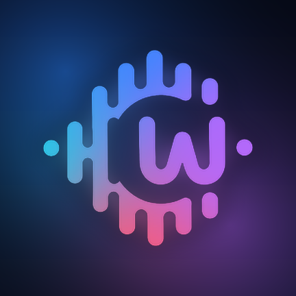

  
  <h1>ClaudeWaves</h1>
  
<strong>Audiophile YouTube Music &amp; Local Audio Player for Android.</strong> Native Kotlin &amp; Jetpack Compose, real-time Liquid Glass &amp; Comic Pop themes, smart 3-layer Best-Part jump, and a custom C++/Oboe bit-perfect audio engine.

  

    
    
    
    
  

  

    <a href="https://github.com/aayepp/ClaudeWaves/releases/latest"><strong>Download Latest APK</strong></a>
    &nbsp;•&nbsp;
    <a href="#screenshots"><strong>Screenshots</strong></a>
    &nbsp;•&nbsp;
    <a href="#feature-highlights"><strong>Features</strong></a>
    &nbsp;•&nbsp;
    <a href="#quick-start"><strong>Quick Start</strong></a>
    &nbsp;•&nbsp;
    <a href="CHANGELOG.md"><strong>Changelog</strong></a>
  

---

## Screenshots

> **Gallery slot ready** — add screenshots to `docs/screenshots/` (`home.png`, `player.png`, `lyrics.png`, `comic_pop.png`, `audio_eq.png`, `library.png`) and uncomment the table below.

<!--

  <table>
    <tr>
      <td align="center"> <strong>Home Feed &amp; Mood Chips</strong></td>
      <td align="center"> <strong>Now Playing &amp; Best Part</strong></td>
      <td align="center"> <strong>Word-by-Word &amp; Duet Lyrics</strong></td>
    </tr>
    <tr>
      <td align="center"> <strong>Comic Pop Skin &amp; Accents</strong></td>
      <td align="center"> <strong>Parametric EQ, AutoEQ &amp; USB DAC</strong></td>
      <td align="center"> <strong>Library, Downloads &amp; Local Music</strong></td>
    </tr>
  </table>

-->

---

## What Makes ClaudeWaves Different

Most Android music clients wrap a basic player around a list of songs. **ClaudeWaves** is engineered natively from the ground up to combine **hardware-level audiophile playback**, **120Hz fluid motion &amp; Liquid Glass**, **offline-first listening**, and **deep personalisation** in one lightweight APK.

| Highlight | What You Get |
| :--- | :--- |
| **Native C++ / Oboe Audio Engine** | Bit-Perfect USB DAC exclusive output (bypasses Android resampling), 10-band Parametric EQ, AutoEQ target curves for thousands of IEMs/headphones, and Automix DJ crossfade. |
| **Liquid Glass &amp; Comic Pop** | Real-time Android 12+ backdrop blur, Liquid Glass droplet toggle switches, specular rims, artwork-tinted glass, plus a full **Comic Pop** ink-and-paper skin that remembers your custom accent colour. |
| **Smart 3-Layer Best-Part Jump** | Jumps straight to the chorus, viral bridge, or beat drop using YouTube heatmaps (including official MV counterparts), chapter markers, fuzzy/CJK chorus analysis, and on-device audio energy fallback. |
| **Word-by-Word &amp; Duet Lyrics** | Karaoke word-sync, overlapping duet vocal focus, instant next-track lyric preloading, offline caching, per-track timing offset, built-in translation &amp; romanization, and shareable lyric cards. |
| **Living Visuals &amp; Synced Video** | Animated album covers (Canvas) that keep playing **offline** once viewed, plus one-tap synced **Music Video** mode inside Now Playing. |
| **Hi-Res Lossless Addons &amp; Offline** | Built-in tutorial addon websites (`Palv`, `Radha`) and custom HTTP addon support for Hi-Res FLAC streaming, automatic smart offline caching, full downloads, and local device audio scanning. |

---

## Feature Highlights

### 1. Audiophile Audio Pipeline (C++20 / Oboe)
- **Bit-Perfect USB DAC Output:** Dedicated exclusive USB audio driver bypasses Android's mixer and sample-rate conversion for unaltered playback.
- **10-Band Parametric EQ &amp; AutoEQ:** Fine-tune frequency, gain, and Q-factor per band or load measured AutoEQ profiles for your exact headphones/IEMs.
- **Automix Crossfade:** Tempo- and phrase-aware DJ-style transitions between tracks.
- **Hi-Res Lossless Addons:** Connect personal or custom HTTP addon servers to stream and download lossless FLAC alongside YouTube Music (with `Palv` and `Radha` generator websites ready in Settings).
- **16 KB Page-Aligned Native Libraries:** Built for Android 15–17 devices with modern native audio libraries.

### 2. Signature Design, Liquid Motion &amp; Themes
- **Liquid Glass (Android 12+):** Real-time backdrop blur, adaptive light/dark ink over scrolling content, Liquid Glass droplet toggle switches, frosted bottom sheets, and an interactive intensity slider in Settings.
- **Comic Pop Skin:** Full bold-ink, halftone, offset-shadow aesthetic in Light and Dark modes — with independent accent colour memory so toggling Comic Pop never resets your chosen palette.
- **AMOLED &amp; Dynamic Colour:** True `#000000` AMOLED dark mode, wallpaper Dynamic Colour, Dynamic Now Playing palette, custom app icons, and selectable display refresh rate.
- **Full-Screen "See All" Everywhere:** Every Feed shelf (`Quick Picks`, `Favourite Artists`, `Your Mixes`, `Jump Back In`, `Hi-Res Picks`, `On Repeat`, mood chips, etc.) expands into a full-screen grid or track list with Play All &amp; Shuffle.

### 3. Living Now Playing &amp; Smart Lyrics
- **3-Layer Best-Part Detection:** Combines YouTube watch heatmaps (audio + duration-matched official MV), YouTube chapters (`Chorus`, `Reff`, `Drop`, `サビ`, `후렴`, `副歌`), multi-section fuzzy/CJK lyric chorus detection, viral bridge peak override, and on-device RMS energy/drop scanning for instrumentals &amp; local files — cached persistently and pre-warmed for the next track.
- **Animated Artwork Offline:** Motion covers cache locally after first view so they remain alive offline.
- **Synced Music Video:** Switch between audio and synced video in one tap without losing playback position.
- **Next-Gen Lyrics:** Word-by-word karaoke sweep, duet vocal focus, translation, romanization, per-song offset adjustment, offline storage, and shareable lyric posters.

### 4. Effortless Gestures &amp; Ecosystem
- **Fluid Gestures:** Scrub the bottom navigation bar to glide the tab pill; pull up the mini player for a flying artwork morph; swipe songs to queue; long-press cards for quick preview menus; long-press Home section headers to reorder or hide shelves.
- **Guided 8-Step Setup:** First-time onboarding sets up your profile name/photo, YouTube Music &amp; Spotify links, live theme preview, addons, audio quality, permissions, and an interactive gesture tour (repeatable anytime from **Settings → About**).
- **Connected Everywhere:** YouTube Music &amp; Spotify playlist import, Last.fm scrobbling &amp; listening stats, Listen Together (Jam) synced rooms, Discord Rich Presence, Google Cast, Android Auto, Glance home-screen widgets, and in-app updates.

---

## Quick Start

1. Download **`ClaudeWaves.apk`** from [**Latest Releases**](https://github.com/aayepp/ClaudeWaves/releases/latest) (universal `arm64-v8a` &amp; `armeabi-v7a`, **Android 9.0 – 17**).
2. Install the APK (allow *Install unknown apps* if Android prompts).
3. Follow the optional 8-step setup wizard — sign in to YouTube Music for personalised shelves, pick Liquid Glass or Comic Pop, and optionally link a Hi-Res addon.
4. Stay up to date directly inside the app via **Settings → About → Check for Updates**.

### Verify APK Integrity
Every official release includes `SHA256SUMS.txt` alongside `ClaudeWaves.apk`, signed by the official release certificate (`SHA-256` fingerprint verified automatically in CI before publishing).

---

## FAQ

<strong>Does ClaudeWaves require a YouTube Music or Spotify account?</strong>

No. You can stream, search, browse charts, and play local device audio without signing in. Signing in to YouTube Music unlocks your personalised Home feed, liked songs, and playlists; Spotify linking is optional for playlist import and Canvas covers.

<strong>How do Hi-Res Lossless Addons work?</strong>

Open <strong>Settings → Addons</strong>. Generator websites (<code>Palv</code> and <code>Radha</code>) are listed by default under <em>Addon websites</em> so you can open one, copy your personal addon URL, and connect it in a tap.

<strong>How do I report a bug or request a feature?</strong>

Open <strong>Settings → About → Report a Bug</strong> inside the app — it opens GitHub Issues with your app version, Android version, and device info pre-filled, or tap <strong>Copy Debug Info</strong> to paste it manually.

---

## License (GNU GPL v3)

ClaudeWaves (`com.claudewaves.app`) is free and open-source software licensed under the **GNU General Public License v3.0**. See [LICENSE](LICENSE) and [NOTICE](NOTICE) for full details.
